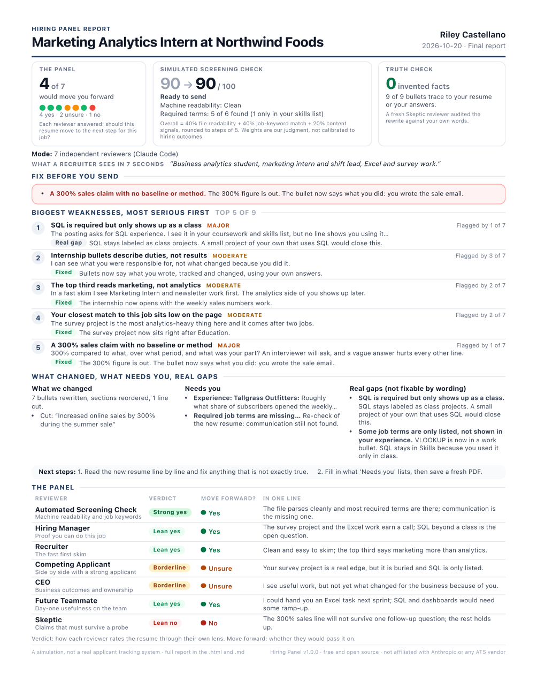
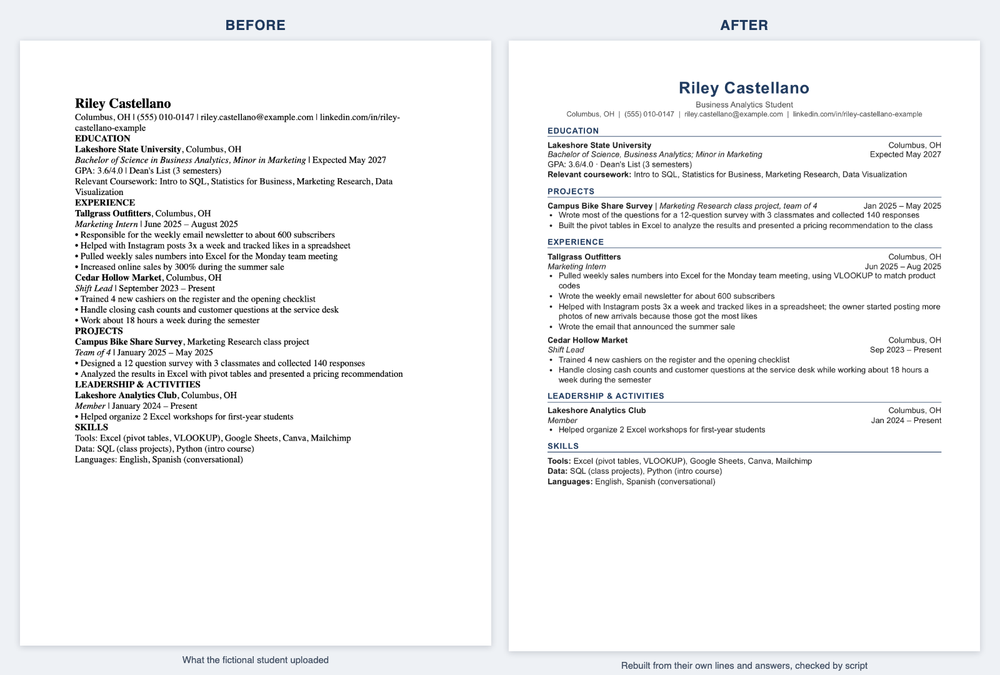

# Hiring Panel

**Get your resume rejected by seven reviewers before a real hiring team ever sees it. Then
get it rebuilt from your actual experience.**

> **Free and open source.** Works on Claude's Free plan as a single-chat panel. The fully
> parallel 7-reviewer panel runs in Claude Code (Pro or Max plan).
>
> **Do the setup on a computer.** Phones aren't tested yet.

Hey, I'm Joshua ([@joshualarosa.ai](https://www.instagram.com/joshualarosa.ai/) on
Instagram). I built Hiring Panel because most students send out resumes that nobody has
given them honest feedback on. This gives you that feedback in one sitting, puts the
biggest problems first, and then fixes what can be fixed without making anything up. It's
free, and it stays free.

**Jump to:** [What it does](#what-it-does) · [Step 0](#step-0-turn-on-code-execution) ·
[Install](#install-pick-one) · [First message](#your-first-message) ·
[What you get](#what-you-get) · [What to expect](#what-to-expect) · [Privacy](#privacy) ·
[Troubleshooting](#troubleshooting) · [Honesty promise](#my-honesty-promise) · [FAQ](#faq) ·
[Credits](#credits)

## What it does

1. **Automated Screening Check.** A script reads your file the way parsing software might,
   then checks for readability problems and for keywords from the job posting that your
   resume doesn't show. It's a simulation, and it says so: you get one number (in steps of
   5), a plain-English band, and exact counts like "Required terms: 7 of 11 found".
2. **Hiring Manager.** Would they spend 45 minutes interviewing you?
3. **Five more reviewers:** a **Recruiter** (the 7-second skim), a **Competing
   Applicant** (would your resume win side by side?), the **CEO** (would you move
   something the business cares about?), a **Future Teammate** (could you pitch in from
   your first week?) and a **Skeptic** (which lines wouldn't survive a follow-up question?).
   - In **Claude Code**, each reviewer is a separate Claude that reads your resume on its
     own, at the same time as the others.
   - On **claude.ai**, one Claude plays all seven, one after another. That way the
     reviewers aren't fully independent, and your report says so.
4. **Combined feedback, biggest weaknesses first.** A script merges what the reviewers
   found and ranks it by how serious it is, how many reviewers flagged it, and how early
   in hiring it would hurt you. Your report leads with that list, right after the vote.
5. **An improved resume built around your actual experience.** It only uses facts from
   your resume and your answers. If a bullet needs a number you didn't give, it asks you.
   A script checks every line against your original before any file gets built.
6. **Your files:** the new resume as **.docx, .pdf and .md**, and the report as a
   **one-page .pdf**, plus **.md** and **.html** versions with everything in them.

## Step 0: turn on code execution

Hiring Panel runs small scripts, so Claude needs permission to run code.

1. On [claude.ai](https://claude.ai), open **Settings > Capabilities**. (Settings is in
   the menu that opens when you click your name.)
2. Find **Code execution and file creation** and turn it on.

On a school or work account, an admin may have to allow this (and plugins or skills) for
your organization. If the setting is missing or greyed out, that's why. *Last checked:
October 2026.*

## Install (pick ONE)

Choose one of A, B or C. Installing more than one gives you duplicate copies (see the
[FAQ](#faq) to remove extras).

### A. Recommended: add the marketplace (nothing to download)

1. Go to [claude.ai/customize/plugins](https://claude.ai/customize/plugins), or
   **Customize > Plugins** in the Claude desktop app.
2. Click **Add**, then **Add marketplace**.
3. Paste this and confirm:
   ```
   joshualarosa902-dev/hiring-panel
   ```
4. Find **Hiring Panel** in the list and add it.
5. Optional: turn on **Sync automatically** for that marketplace so you get fixes.

You'll know it worked when **Hiring Panel** shows in your plugin list, turned on.
It also shows up in Claude Code on the same account the next time you start a session
(or run `/reload-plugins`). If you don't see **Plugins** or **Add marketplace**, your plan
or school account may not offer it yet. Use option C.

### B. Upload the plugin file

1. Download
   [hiring-panel.plugin](https://github.com/joshualarosa902-dev/hiring-panel/releases/latest/download/hiring-panel.plugin).
2. Go to **Customize > Plugins**, click **Add**, then **Upload plugin**, and choose the file.
3. Check that **Hiring Panel** now shows in your plugin list, turned on.

### C. Upload just the skill

1. Download
   [hiring-panel-skill.zip](https://github.com/joshualarosa902-dev/hiring-panel/releases/latest/download/hiring-panel-skill.zip).
2. Go to **Customize > Skills**, click **+**, then **+ Create skill**, then **Upload a
   skill**, and choose the zip.
3. Check that **hiring-panel** now shows in your skills list, turned on.

**Using Safari?** It may unzip the download into a folder called `hiring-panel`, and the
upload needs the zip itself. The cleanest fix: turn off **Safari > Settings > General >
Open "safe" files after downloading**, then download again. You can also use option B
instead, or right-click the `hiring-panel` folder, choose **Compress "hiring-panel"**, and
upload the new `hiring-panel.zip`.

### Claude Code

If you used option A with the same account, it's already there; skip this. Otherwise, in
Claude Code:

```
/plugin marketplace add joshualarosa902-dev/hiring-panel
/plugin install hiring-panel@hiring-panel
```

Choose **Install for you (user scope)**. To get fixes automatically: run `/plugin`, open
the **Marketplaces** tab, select **hiring-panel**, then **Enable auto-update**.

Rather not type commands? Paste this into Claude Code and let Claude do the setup:

```
https://github.com/joshualarosa902-dev/hiring-panel  Install this skill, then confirm /hiring-panel works.
```

The first time Hiring Panel runs a script or saves a file, Claude Code asks permission.
Pick the option that stops it asking again for this session. The scripts read your files
and save their work in a `hiring-panel-runs` folder.

## Your first message

Start a new chat, attach your resume (PDF or Word), paste the job posting text, and type:

> Use Hiring Panel to review my resume for this job.

You can also pick **Hiring Panel** from the `/` menu. In Claude Code you can do it in one
line: the command, your resume file, then the job (the posting text, a link, or just the
role):

```
/hiring-panel ~/Documents/resume.pdf Marketing intern at Northwind
```

If `/hiring-panel` doesn't show up, use the full name: `/hiring-panel:hiring-panel`.

- **No posting yet?** Try "Use Hiring Panel to review my resume for marketing
  internships." You'll get a General review: format and content checks, no keyword match.
- **On the Free plan?** Say so in your message. Claude then runs the lighter single-chat
  panel, which uses less of your plan.
- **On Pro?** Add "quick run" to use less of your plan: Claude Code then runs the
  reviewers on a lighter model, and claude.ai uses the lighter single-chat panel.
- **Paste the posting text** rather than a link. LinkedIn, Handshake and Workday pages
  usually need a login, so Claude can't read them.

## What you get

| File | What's in it |
|---|---|
| `First_Last_Resume.docx` | Your improved resume, ready to edit in Word or Google Docs |
| `First_Last_Resume.pdf` | The same resume as a PDF |
| `First_Last_Resume.md` | Plain text version, handy for pasting into application forms |
| `Hiring_Panel_Report.pdf` | One page: the vote, what to fix before you send, your biggest weaknesses, what changed, the panel |
| `Hiring_Panel_Report.md` and `.html` | The full report: plus where the panel disagreed, keyword gaps, what's already working, interview prep |

You get the report **before** the rewrite, so if anything cuts the chat off, you still
have all the feedback. A fictional example of every file lives in
[examples/sample-run/](examples/sample-run/).





## What to expect

> - **Time:** when I tested it in Claude Code, a full run took about 15 to 20 minutes
>   from start to finished files. The seven-reviewer panel took about 4 minutes of that,
>   with the reviewers working in parallel. These are rough numbers from one test run;
>   yours will vary with your resume, the posting and how busy Claude is.
> - **Plan usage:** a full run uses a substantial amount of your plan, because each of
>   the seven reviewers reads its own instructions and your resume, and then the rewrite
>   gets checked. On Pro, say "quick run" to use a lighter model in Claude Code (or the
>   lighter single-chat panel on claude.ai). On the Free plan, Hiring Panel uses the
>   lighter single-chat panel. If you hit a limit, the report you already downloaded
>   keeps the feedback.
> - **Questions:** before rewriting, Claude asks one short batch (at most 7, or 8 for a
>   very short resume), one fact per question. Answer what you can, or reply "skip".
> - **"Simulated screening check"** means a script imitates the parts of applicant
>   tracking software that are publicly documented. It is not a real company's system.
>   The score is: 40% file readability + 40% job-keyword match + 20% content signals,
>   rounded to steps of 5. Those weights are our judgment, not a prediction.
> - **No guarantees.** Nobody can promise interviews, and this doesn't. It shows you what
>   to fix and fixes what it honestly can.
> - **Real gaps stay real.** If the job needs something you don't have, the report says so
>   and suggests honest ways to close it. It won't paper over it.

## Privacy

> - **Where your files live.** On claude.ai: in that chat's sandbox, and the files you
>   download. In Claude Code: a `hiring-panel-runs` folder inside the folder you opened,
>   with its own `.gitignore` so it doesn't get committed by accident. Claude warns you if
>   that folder is inside a git repository.
> - **No telemetry.** Hiring Panel's scripts make no network calls and send nothing
>   anywhere. Automated tests check this on every change.
> - **Masked contact details.** Your email and phone are masked in the report and in chat
>   summaries.
> - **Your Claude settings still apply.** Your conversation is a normal Claude chat. In
>   **Settings > Privacy**, check the **Help improve Claude** setting; how long chats are
>   kept depends on it (see [Anthropic's consumer terms](https://www.anthropic.com/legal/consumer-terms)).
>   You can delete the chat when you're done.
> - **Claude Code keeps transcripts locally,** including each reviewer's, under
>   `~/.claude/projects` on your computer. By default they're cleaned up after 30 days.
> - **Never post your real resume in a GitHub issue.** Use made-up or redacted text.

More detail: [docs/privacy.md](docs/privacy.md).

## Troubleshooting

| What you see | Try this |
|---|---|
| Claude doesn't use Hiring Panel | Say "Use Hiring Panel" in your message, or pick it from the `/` menu. Check it's turned on in Customize > Plugins (or Skills). |
| "Code execution is disabled" or Claude can't create files | Do [Step 0](#step-0-turn-on-code-execution). School and work accounts may need an admin. |
| The skill upload fails | Upload the zip itself, not a folder (see the Safari note in option C). Download it again from the link above; don't zip the repository yourself. |
| A Mac pop-up asks to install developer tools | Click **Cancel**. Hiring Panel keeps going in manual mode. If you want the full version, install Apple's free Command Line Tools later and run it again. |
| Claude Code keeps asking permission | Choose the "don't ask again for this session" option. |
| You hit a usage limit | Download the report you already have. Later, say "continue" in the same chat, or start a new chat for a fresh run. |
| The PDF is missing | Open the .docx in Word, Google Docs or Pages and save it as PDF. |
| Where are my files? | claude.ai: the download cards in the chat. Claude Code: the `hiring-panel-runs` folder in the folder you started from. |
| The job link didn't work | Paste the posting text instead. |
| Hiring Panel shows up twice | You installed it more than once. See the [FAQ](#faq). |
| `/hiring-panel` opens a different skill | You also have Alex Chen's original hiring-panel skill (see [Credits](#credits)). Both use the same command name, so keep only one. To remove his in Claude Code, run `/plugin uninstall hiring-panel-skill@hiring-panel-skill`, or delete the `~/.claude/skills/hiring-panel` folder if you copied it there. Until you do, type `/hiring-panel:hiring-panel` to open this one. |

## My honesty promise

- **Nothing invented.** No new employers, titles, dates, numbers, tools, skills or
  results. "Helped" never becomes "led". A script checks every line against your original
  resume and your answers before the files get built, and a separate check looks for
  invented outcomes.
- **One number, clearly labeled.** The only score is the simulated screening check. The
  reviewers vote; they don't hand out made-up ratings.
- **Disagreements stay visible.** When reviewers disagree, the report shows both sides
  instead of averaging them away.
- **The mode is always disclosed.** If your panel ran in a single chat, the report says so.
- If you ever catch Hiring Panel making something up, that's the most important bug there
  is. Please [open an issue](https://github.com/joshualarosa902-dev/hiring-panel/issues) with made-up
  or redacted text.

## FAQ

**Is it really free?** Yes. Hiring Panel is MIT-licensed and costs nothing. You need a
Claude account, and runs count toward your plan's normal usage.

**Does it work on the Free plan?** Yes, as a single-chat panel. The fully parallel panel,
where seven separate Claudes read your resume at the same time, needs Claude Code, which
comes with Pro and Max.

**Is this a real applicant tracking system?** No. It's a simulation based on what the
vendors publicly document. It's useful for catching problems, but real systems differ by
employer.

**Will it get me interviews?** It can't promise that, and nothing honest can. It shows you
the weaknesses a hiring team would likely see and fixes the ones writing can fix.

**Will it make things up to make me look better?** No. That's the whole point. See the
[honesty promise](#my-honesty-promise).

**What files can I use?** PDF, Word (.docx) or plain text, or just paste your resume.
Scans and photos work too: Claude types out the text and asks you to confirm it. For
Pages or old .doc files, export to .docx or PDF first.

**Does it work for CVs outside the US?** Yes. It adjusts paper size, page length, "CV"
versus "resume", photo and date-of-birth norms, and GPA versus degree classification for
your country. English resumes get the full keyword check; other languages get everything
except the keyword match.

**Can it write my cover letter or LinkedIn summary?** Not in this version. At the end it
can quiz you with the interview questions the panel would ask.

**How do I update it?** Option A: turn on **Sync automatically** (or use **Check for
updates**). Claude Code: turn on auto-update as shown above. Options B and C: download the
new file and upload it again.

**How do I remove extra copies?** In **Customize > Plugins**, open Hiring Panel, open its
menu and choose **Remove**. In **Customize > Skills**, turn off or delete the extra
hiring-panel skill. Keep one.

**I'm under 18. Can I use it?** Claude's terms require users to be 18 or older, so
Hiring Panel is for Claude users 18+. Your school's career center is a great place to get
resume feedback in the meantime.

**Where's the technical detail?** [docs/how-it-works.md](docs/how-it-works.md) explains
the pipeline, and [SECURITY.md](SECURITY.md) covers how to report a problem.

## Credits

Inspired by the original hiring-panel skill by Alex Chen (@nocodealex), MIT licensed:
[github.com/alexyc9381/hiring-panel-skill](https://github.com/alexyc9381/hiring-panel-skill).
This version is a from-scratch rebuild with a deterministic screening check,
evidence-checked rewrites, Word/PDF output and claude.ai support. Thank you, Alex, for the
idea.

---

MIT License ([LICENSE](LICENSE)) · Not affiliated with Anthropic or any ATS vendor · For
Claude users 18+ · Third-party credits in [NOTICE](NOTICE) · How to cite:
[CITATION.cff](CITATION.cff) · Version 1.0.0 ([CHANGELOG](CHANGELOG.md))
